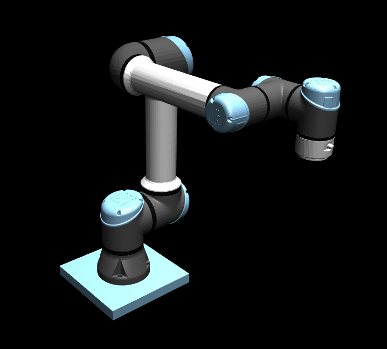
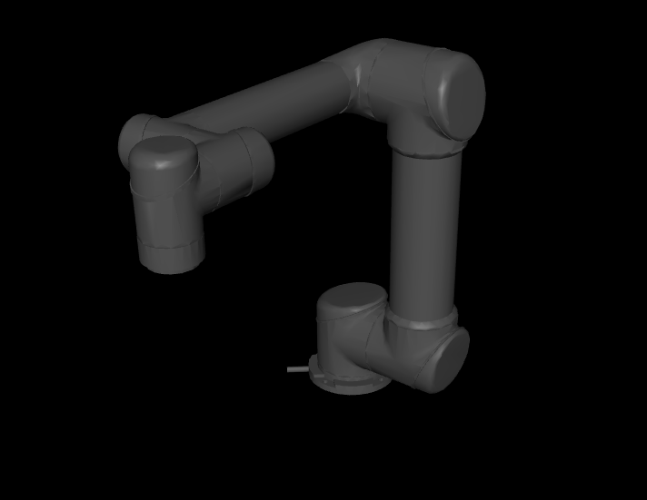
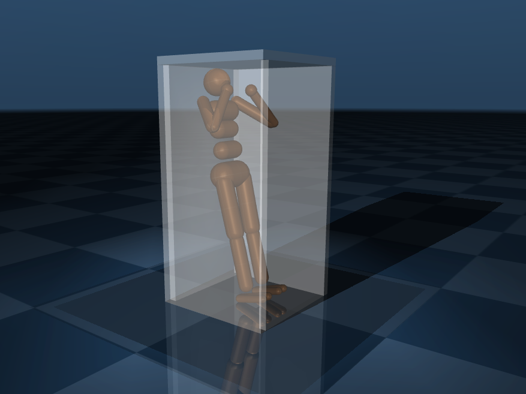

<h1 align="center">

</h1><br>

<div align="center">
    <!-- Row 1: Package info -->
    
    
    <a href="https://pypi.org/project/mujoco-toolbox/">
        
    </a>
</div>

<div align="center">
    <!-- Row 2: Build/CI status -->
    
    <a href="https://github.com/MGross21/mujoco-toolbox/actions/workflows/publish.yml">
        
    </a>
    <a href="https://github.com/MGross21/mujoco-toolbox/actions/workflows/docs.yml">
        
    </a>
</div><br>

A Modern Simulation Wrapper for Google DeepMind’s MuJoCo

> **⚠️ WARNING**  
> This package is currently in its zero-release stage. Class methods and APIs may change without prior notice. Please review the documentation and changelog after each update to stay informed about any modifications.

## Installation

<!-- docs-install-start -->

*Add `-U` flag to upgrade pre-existing library*

### PyPI Package

[](https://pypi.org/project/mujoco-toolbox/)

```bash
pip install mujoco-toolbox
```

Everything is included: simulation, rendering, video export (ffmpeg is bundled), the viewer, and MuJoCo Studio.

### GitHub Package

[](https://github.com/MGross21/mujoco-toolbox/releases)

```bash
pip install git+https://github.com/MGross21/mujoco-toolbox.git@main
```


### Adding to Project Dependencies
<details>

<summary><b>Click to Expand</b></summary><br>


Place the following in your `requirements.txt` or `pyproject.toml` file.

### PyPI

Expect less frequent, stable releases.

```text
mujoco-toolbox
```

### Github

Expect frequent rolling releases.

```text
mujoco-toolbox @ git+https://github.com/MGross21/mujoco-toolbox.git@main
```

</details>

<!-- docs-install-end -->
<!-- docs-usage-start -->
## Example Script

*Bare minimum to run MuJoCo simulation and display result*

```python
import mujoco_toolbox as mjtb

mjtb.Simulation("path/to/your/xml").run(render=True).save()
```

## Data Capture

`run()` returns a `Recording`: capture times, `MjData` fields at `capture_rate` captures per second, and any rendered frames. Each field is an array of shape `(captures, *field_shape)`.

```python
import mujoco_toolbox as mjtb

rec = mjtb.Simulation("path/to/xml").run(5, capture_rate=100, capture={"qpos", "xpos"})
rec.time  # (500,)
rec.data["qpos"]  # (500, nq)
rec.body("arm", "xpos")  # (500, 3)
rec.clip(1, 2)  # the same recording, between 1 s and 2 s
rec.save_data("run.npz")  # np.load("run.npz")["qpos"]
```

Omit `capture` to record `mjtb.DEFAULT_CAPTURE`, or pass `capture="all"` to record every numeric field. Each run returns a new `Recording`, so runs can be compared side by side.

## Rendering

```python
rec = mjtb.Simulation("path/to/xml").run(5, render=True, fps=30, resolution=(640, 480), camera="top")
rec.save("run.mp4")  # or .gif, .webm, ...
rec.clip(2, 3).show()  # inline in Jupyter, otherwise in your video player
rec.frame_at(2.5)  # one frame as an (height, width, 3) array
```

## Controllers

### Pre-Made Controllers

The following controllers are available out-of-the-box:

- `sin`
- `cos`
- `step`
- `random`

Each one builds a controller from its settings:

```python
mjtb.Simulation("path/to/xml", controller=mjtb.sin(amplitude=0.5, frequency=2)).run()
```

### Custom

Any function taking `(model, data)` works; it is called once per step.

```python
def hold(model: mujoco.MjModel, data: mujoco.MjData) -> None:
    data.ctrl[:] = 0.1


mjtb.Simulation("path/to/xml", controller=hold).run()
```

## Instantiating a Digital Twin

`launch()` opens the viewer and returns a handle. `set()` writes live `MjData` fields, thread-safely.

```python
import mujoco_toolbox as mjtb

with mjtb.Simulation("path/to/xml").launch(show_menu=False) as viewer:
    while viewer.running:  # until the window is closed (or ESC/Q)
        viewer.set(qpos=read_robot_joints())
```

See the [`MjData` field reference](https://mujoco.readthedocs.io/en/stable/APIreference/APItypes.html#mjdata).

## Settling Before a Run

`settle()` simulates until the model comes to rest and starts every later run from that pose.

```python
mjtb.Simulation("path/to/xml").settle().run(render=True).save()
```

## Conditional Recording

`record_when` records data and frames only on steps where it returns `True`.

```python
rec = mjtb.Simulation("path/to/xml").run(render=True, record_when=lambda d: d.qpos[2] < 0.1)
```

## Parameter Sweeps

`sweep()` runs one copy per row on MuJoCo's batch thread pool and returns one `Recording` per copy. Keys are `MjData` state fields or `MjModel` fields (`opt.<name>` for options).

```python
earth, moon = mjtb.Simulation("path/to/xml").sweep({"opt.gravity": [[0, 0, -9.81], [0, 0, -1.62]]}, duration=2)
moon.data["qpos"]
```

## MuJoCo Studio

```python
mjtb.Simulation("path/to/xml").studio(hot_reload=True)  # reloads when the file changes
mjtb.Simulation("path/to/xml").studio(web=True)  # browser viewer on port 8080
```

> **⚠️ WARNING**
> The browser viewer has no authentication and listens on every network interface.

## File Support

### XML / MJCF (Native)

```python
import mujoco_toolbox as mjtb

mjtb.Simulation("path/to/xml").launch()
```



### URDF

```python
import mujoco_toolbox as mjtb

mjtb.Simulation("path/to/urdf", meshdir="path/to/mesh/files").launch()  # supports *.stl or *.obj
```



## Merging Capabilities

Sources are merged in order into one model that shares a single namespace: MJCF and URDF files or strings, bare elements such as `<asset>`, and `mujoco.MjSpec` objects. Settings such as `<compiler>` and `<option>` come from the first source.

```python
import mujoco_toolbox as mjtb

sim = mjtb.Simulation("scene.xml", "robot.urdf", mjtb.WORLD_ASSETS, mjtb.glovebox(), meshdir="meshes/")
sim.spec  # the merged mujoco.MjSpec, for editing; mjtb.Simulation(sim.spec) compiles it
sim.xml  # the merged model as MJCF
```

> **⚠️ WARNING**  
> Names must be unique across sources; a repeated name raises `ValueError`.


